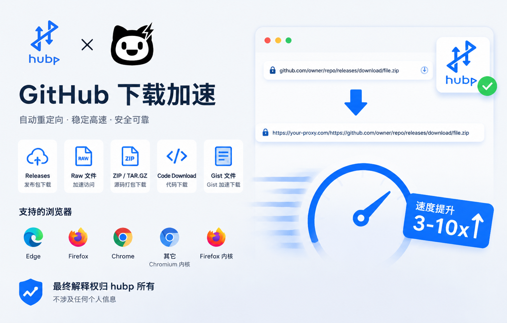

# GitHub Accelerator - GitHub 下载加速器

<table style="border: none; width: 100%;">
<tr>
<td width="35%" align="center" valign="middle" style="border: none;">

Made by

</td>
<td width="65%" align="center" valign="middle" style="border: none;">

</td>
</tr>
</table>

智能 GitHub 下载加速器 - 加速链接模式 · 拦截页面模式 · 支持 IDM 等下载工具

## 📖 项目简介

GitHub Accelerator 是一款智能的浏览器扩展，专为解决中国大陆地区访问 GitHub 下载资源慢的问题而设计。通过自动选择最优代理节点，实现 GitHub 资源下载加速，支持所有下载场景。

## ✨ 主要功能

- 🚀 **智能加速**：自动选择最优代理节点，无需手动配置
- 🌏 **地理位置检测**：智能识别用户所在地区，自动判断是否需要加速
- 🎯 **加速链接**：自动选择最优节点生成加速链接，兼容 IDM 等下载工具[用户须知](#%EF%B8%8F-%E6%B3%A8%E6%84%8F%E4%BA%8B%E9%A1%B9)
- 🛡️ **抗 IDM 绕过**：页面级 `click` / `a.click()` hook，在 IDM 等下载器之前拦截下载点击，确保先进入加速选择流程，原始链接不会被直接抓走
- 🐵 **油猴脚本**：不装扩展也能用，Tampermonkey / Violentmonkey 版本见下文
- 📢 **公告**：在 popup、下载拦截页、统计页展示官网公告，信息 / 警告 / 严重三级配色，支持关闭并本地记忆
- 🔗 **官网联动**：在 hubp.org 页面只读共享本地节点测速结果与使用计数
- 🎯 **节点测速**：支持手动节点测速，选择最快节点
- 💾 **缓存机制**：2 小时缓存最优节点，避免重复测速
- 🔧 **灵活配置**：支持全局加速偏好设置
- 📊 **状态监控**：实时显示节点状态、延迟、缓存等信息

## 📦 安装方式

### 扩展商店安装（推荐）

- **Microsoft Edge 扩展商店**: [GitHub Accelerator](https://microsoftedge.microsoft.com/addons/detail/pingkpgackfhaonibagjlibmobkhgdml)
- **Firefox Add-ons 商店**: [GitHub Accelerator](https://addons.mozilla.org/addon/github-accelerator/)
- **Chrome Web Store**: [GitHub Accelerator](https://chromewebstore.google.com/detail/github-accelerator-github/bcbnfbcmbcoogjihnoediilgpfohkdef)

### 手动安装

#### Chrome/Edge 浏览器

1. 从 [Releases](https://github.com/hubporg/ghproxy-extension/releases) 下载 `.crx` 文件
2. 打开浏览器扩展管理页面：
   - Chrome: `chrome://extensions/`
   - Edge: `edge://extensions/`
3. 开启右上角的"开发者模式"
4. 将 `.crx` 文件直接拖拽到扩展管理页面即可安装

#### Firefox 浏览器

1. 从 [Releases](https://github.com/hubporg/ghproxy-extension/releases) 下载 `.xpi` 文件
2. 浏览器会询问你是否安装，点击同意。

## 🐵 油猴脚本版本

不想安装扩展时，可以用 Tampermonkey / Violentmonkey 运行同名脚本，能力按扩展对齐：

- **脚本文件**：[userscript/github-accelerator.user.js](userscript/github-accelerator.user.js)（v0.4.0）
- **安装**：油猴管理面板 → 新建脚本 → 粘贴整份内容保存；首次运行先弹出隐私说明，同意后才启用；安装时允许 `@connect *`（节点测速会请求所有节点域名）
- **首次隐私确认**：与扩展打开隐私页的行为一致，未同意前不拦截、不测速；可在脚本菜单「隐私设置」里重新开启
- **注入式拦截**：点击下载链接时在页面内注入与扩展 intercept 页一致的拦截 UI（节点选择、原始/加速链接、复制、倒计时、始终加速、返回），不需要扩展的独立拦截页
- **页面级 hook**：捕获阶段 `click` 拦截 + `unsafeWindow.HTMLAnchorElement.prototype.click` hook（`@sandbox raw`），`a.click()` 这类脚本触发下载也会先进入拦截流程（对齐扩展 `main-hooks.js` 的抗 IDM 逻辑）
- **节点测速**：与扩展同一 `nodes.json` 源、并发测速、2 小时缓存；拉取云端 icon 做 SHA-256 校验，内容不一致的节点直接排除（对齐扩展 `testSingleNode`）
- **匿名统计**：与扩展 `stats.js` 同一接口与 payload（`jumps/installs/browser/version/source/timestamp`），批量 5 次或每 5 分钟提交，受隐私同意控制；后端按 `source` 区分扩展与油猴来源
- **浮标 + 面板**：右下角浮标点开 popup 风格面板，含节点测速、自定义节点、地理位置、缓存剩余、公告、始终加速
- **官网联动**：在 hubp.org 页面按 `{ __ghAccelSite: true }` 协议广播本地节点测速与计数，官网 2 小时内可直接复用（与扩展 content script 同一协议）
- **配置隔离**：所有 DOM id / class / 全局变量都带 `ghx9f3a` 前缀，缓存、关闭的公告等只存在油猴本地存储
- **差异**：没有右键菜单；公告关闭记忆与扩展各自独立；Violentmonkey 不支持 `@sandbox` 时 `a.click()` hook 会退化为普通 click 拦截
- **规则同步**：链接规则与 `src/shared/link-patterns.js` 必须一致，改规则后跑 `node userscript/sync-check.mjs` 校验
- **自动更新**：脚本带 `@updateURL` / `@downloadURL`（CDN `hubp.tbedu.top/userscript/`），从更新页安装后由 Tampermonkey / Violentmonkey 自动检查版本；「关于」页还提供「检测更新」按钮，主动比对远端 `@version`，CDN 不可用时回退 GitHub raw
- **日志**：默认只输出一条 `[ghx9f3a] v0.4.0 loaded @ ...` 启动日志；脚本菜单「🐛 调试日志」开启后，F12 Console 会输出节点测速、拦截、位置、公告、统计上报、桥接等详细日志（统一前缀 `[ghx9f3a]`）
- **隐私**：只请求节点接口、测速图片、官网公告、加速链接与匿名统计；不收集浏览历史、不读取页面内容

## 🎯 使用指南

### 基本使用

1. 访问 GitHub 下载链接（Releases、Archive、Raw 等）
2. 扩展会自动拦截并显示加速选项
3. 点击"使用加速链接"即可开始下载

### 加速模式

#### 1. 手动选择模式（默认）

- 访问 GitHub 下载链接时显示拦截页面
- 用户可手动选择"使用加速链接"或"直接访问"

#### 2. 始终加速模式

- 在 popup 页面或拦截页面勾选"始终使用加速链接"
- 访问 GitHub 下载链接时自动跳转，不再显示选择页面

### Popup 页面功能

- **公告**：展示官网发布的最新公告，可关闭（关闭状态保存在本地；下载拦截页与统计页同样会展示）
- **节点选择**：查看和选择代理节点（支持API节点和自定义节点）
- **节点测速**：测试所有节点延迟
- **复制地址**：复制当前加速链接
- **自定义节点**：添加、编辑、删除自定义节点
- **地理位置**：显示用户所在地区和网络状态
- **IP重测**：重新检测当前IP地址和地区
- **始终加速开关**：快速启用/禁用自动加速

### 右键菜单功能

在 GitHub 链接上右键点击，可选择：

- 🚀 复制 GitHub 加速链接
- ⚡ 打开 GitHub 加速链接（新标签页）

### 公告与官网联动

- **显示位置**：扩展弹窗（popup）、下载拦截页、统计页（选项页）三个常用页面顶部；三处共用 `src/shared/announcement.js`，同一份关闭记忆。
- **公告来源**：页面打开时异步请求 `https://hubp.tbedu.top/announcements.json`（带时间戳参数绕开缓存）。
- **展示规则**：只展示 `target` 为 `extension` 或 `both` 的公告（`target` 缺失按 `both`，`site` 跳过），并按 `startAt` / `endAt` 过滤生效期，一次只展示第一条。
- **关闭记忆**：`dismissible` 不为 `false` 时显示关闭按钮，关闭后按公告 `id` 记入 `chrome.storage.local`，不再重复打扰；`dismissible: false` 的公告不显示关闭按钮。
- **静默降级**：接口超时、请求失败或返回格式异常时直接跳过公告，popup 其他功能不受影响。
- **官网联动**：在 [hubp.org](https://www.hubp.org) 页面，扩展通过页面内消息把**本地**节点测速结果、当前最优节点和使用计数交给网站展示，网站可复用最近一次测速结果。该过程只读，扩展不会把这些数据上传到任何服务器，网站也无法写入扩展存储。

## 🔍 支持的下载场景

- ✅ GitHub Releases 下载
- ✅ GitHub Archive 下载（ZIP/TAR.GZ）
- ✅ GitHub Raw 文件下载
- ✅ Code Download 下载
- ✅ Gist 文件下载

## 🛠️ 技术原理

1. **地理位置检测**：通过 CloudFlare Trace/IP API 判断用户是否在中国大陆
2. **节点测速**：并发测试所有代理节点，选择延迟最低的
3. **URL 转换**：将 GitHub 原始链接转换为代理加速链接
4. **页面级拦截**：MAIN world 内容脚本在 `document_start` 注入，捕获阶段 hook `click` 事件与 `HTMLAnchorElement.prototype.click`，先于 IDM 等下载器拿到下载点击；再配合 `webNavigation` API 兜底导航类下载
5. **缓存机制**：缓存最优节点 2 小时，避免频繁测速
6. **公告与站点联动**：popup / 拦截页 / 统计页共用 `src/shared/announcement.js` 异步拉取公告 JSON（带时间戳绕缓存，失败静默跳过）；hubp.org 通过只读 content script 以 `postMessage` 同步本地测速结果

## 🔮 TODO

### 计划中的功能

- [x] **油猴脚本版本**（v0.4.0，见 [userscript/](userscript/github-accelerator.user.js)）
  - 与扩展共用节点源与链接规则，页面级拦截，兼容 IDM
  - 无需安装扩展，跨浏览器支持
- [x] 下载统计功能

## ⚠️ 注意事项

1. **公益服务，请勿滥用**：本服务为公益性质，请合理使用
2. **隐私保护**：扩展不会收集任何用户隐私数据
3. **兼容性**：需要 Chrome 111+ / Edge 111+（`world: "MAIN"` 要求）或 Firefox 140+（`data_collection_permissions` 要求）及基于其内核的浏览器
4. **网络环境**：建议配合代理工具使用效果更佳
5. **IDM 用户须知**：
   - 扩展会在页面级优先拦截下载点击，先进入加速选择流程，IDM 不会再直接抓到原始链接
   - 在拦截页面点击"使用加速链接"后，IDM 会弹出下载确认框，此时捕获到的是加速后的链接
   - **建议启用"始终使用加速链接"选项**，访问 GitHub 下载链接时会自动跳转，IDM 将直接捕获加速链接，避免重复确认。~~可能小部分时候会弹2次~~

## 🤝 贡献指南

欢迎提交 Issue 和 Pull Request！

1. Fork 本仓库
2. 创建特性分支 (`git checkout -b feature/AmazingFeature`)
3. 提交更改 (`git commit -m 'Add some AmazingFeature'`)
4. 推送到分支 (`git push origin feature/AmazingFeature`)
5. 开启 Pull Request

## 📄 许可证

MIT License - 详见 [LICENSE](LICENSE) 文件

## 🙏 致谢

- 感谢所有提供公益代理节点的组织和个人
- Powered By [hubp.org](https://www.hubp.org)

## 📧 联系方式

- 项目地址：https://github.com/hubporg/ghproxy-extension
- 问题反馈：https://github.com/hubporg/ghproxy-extension/issues

---

**注意**：本扩展仅用于学习和研究目的，请勿用于商业用途。
